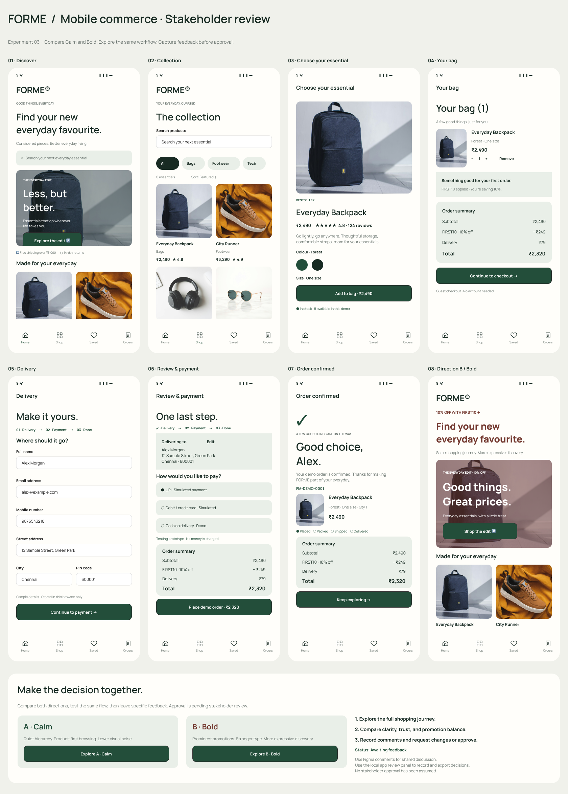
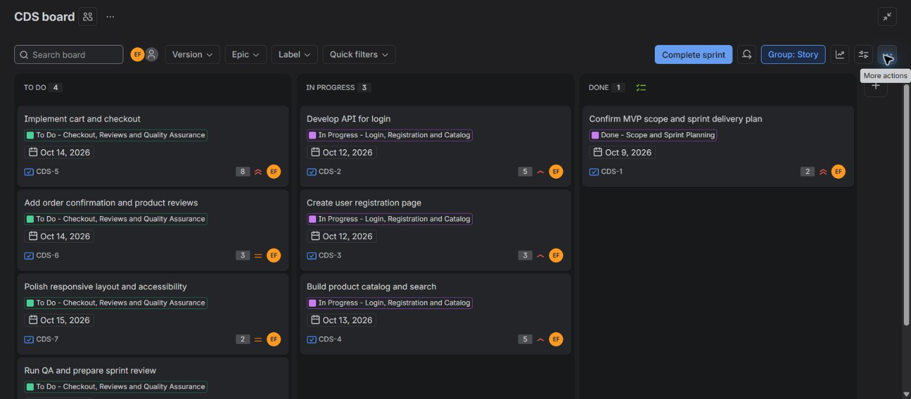
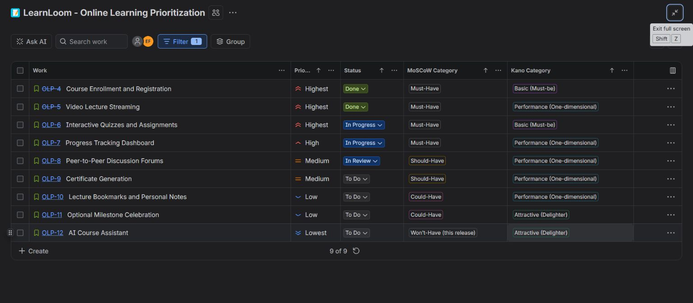

# CSA1020_SOFTWARE_ENGINEERING

A software engineering lab portfolio for **Md-Aslam-31**, organized to follow the numbered experiment structure and evidence style of [CSA1020-Software_Engineering](https://github.com/Md-Aslam-31/CSA1020-Software_Engineering).

This repository contains the first ten experiments, reports, screenshots, workbook, and local application source. Jira workflow snapshots are identified as simulations where applicable. Historical pull-request links retain their original context in the [source repository](https://github.com/Emadfar007/CSA1020---Software-Engineering).

| Experiment | Description | Files |
| --- | --- | --- |
| 01 | Trello Kanban board with five sample tasks and workflow simulation | [Kanban Board](experiments/experiment-01-kanban-board/README.md) |
| 02 | Desktop Figma prototype and local bus booking website with accounts, editable tickets, and personal reviews | [Bus Ticket Booking](experiments/experiment-02-bus-ticket-booking/README.md) |
| 03 | E-commerce mobile prototype in Figma, with a local shopping app and stakeholder review workflow | [E-commerce Stakeholder Prototype](experiments/experiment-03-ecommerce-mobile-app/README.md) |
| 04 | Jira Scrum project with eight prioritized stories, a one-week sprint, workflow simulation, and dated Timeline categories | [Jira Scrum](experiments/experiment-04-jira-scrum/README.md) |
| 05 | Library Management System requirements categorized and justified using MoSCoW in an Excel workbook | [Library MoSCoW Prioritization](experiments/experiment-05-library-moscow/README.md) |
| 06 | Jira and Confluence integration for Library Management System task tracking and sprint progress monitoring | [Jira and Confluence Integration](experiments/experiment-06-jira-confluence/README.md) |
| 07 | Task Management System requirements prioritized using MoSCoW and Kano in Jira, with a sample sprint and progress reporting | [Task Management Prioritization](experiments/experiment-07-task-management-prioritization/README.md) |
| 08 | Online Learning Platform requirements prioritized using MoSCoW and Kano in Jira, with a sample sprint, timeline, and progress reporting | [Online Learning Prioritization](experiments/experiment-08-online-learning-prioritization/README.md) |
| 09 | Git/GitHub fork, clone, feature branch, pull request, disclosed self-review, follow-up fixes, and merge | [GitHub Collaboration](experiments/experiment-09-github-collaboration/README.md) |
| 10 | Real Git branch divergence, two-file merge conflict, manual combined resolution, and a FairSeat feature pull request | [Branching and Merge Conflicts](experiments/experiment-10-merge-conflicts/README.md) |

Each experiment includes only Aim, Tools Required, Algorithm, Output Screenshots, and Result.

## Experiment previews

### Kanban board

### Bus booking desktop prototype

### E-commerce mobile prototype

### Jira Scrum project

The sample Jira project includes a dated Timeline and detailed ownership, acceptance criteria, and dependencies. Its current simulated progress snapshot shows four stories To Do, three In Progress, and one Done. Original sprint-start and sprint-end screenshots are included in Experiment 04.

### Library Management System priorities

Experiment 05 includes a downloadable Excel workbook with all ten requirements, impact, feasibility, and priority justification. The workbook can also be imported into Google Sheets.

### Library Management System task tracking

Experiment 06 links seven Jira stories to a Confluence project overview. Its simulated checkpoint shows two Done, three In Progress, and two To Do tasks, with a manually updated completion snapshot of **28.6%**.

### Task Management System prioritization

Experiment 07 includes twelve requirements across four feature epics, independent MoSCoW and Kano fields, detailed rationale, eight tested filters, 26 prerequisite links, and nine screenshots. Its one-week sample sprint demonstrates To Do, In Progress, In Review, and Done work. Kano classifications remain unvalidated hypotheses, and workflow statuses represent simulated progress.

### Online Learning Platform prioritization

Experiment 08 includes all six requested features within nine detailed requirements, three epics, 16 prerequisite links, seven tested model filters, and ten screenshots. The one-week sample sprint demonstrates progress across four workflow stages. Kano classifications are unvalidated hypotheses, and workflow progress is simulated.

### Git and GitHub collaboration

Experiment 09 includes ten screenshots documenting a fork of octocat/Spoon-Knife, a working LearnLoop dashboard, two feature commits, review feedback, passing checks, and [merged pull request #1](https://github.com/Emadfar007/learnloop-collaboration-demo/pull/1). Its navigation follow-up adds distinct Learning path, My progress, and Workflow guide views, verified across 16 browser checkpoints and merged in [pull request #2](https://github.com/Emadfar007/learnloop-collaboration-demo/pull/2). All 13 tests passed. Only Emadfar007 was used, so the review is explicitly a self-review informed by assistant code inspection, without independent human approval. The merges target the user's fork's main branch.

### Git branching and merge conflicts

Experiment 10 demonstrates genuine conflicts in the seat allocator and release policy, generated through two local clones using Emadfar007. The manual resolution preserves VIP-first ordering, overflow waiting lists, capacity validation, and valid attendee records. The experiment includes captured Git output, nine screenshots, a local evidence journal, 20 passing tests, and ten planner browser checks. [Pull request #1](https://github.com/Emadfar007/CSA1020---Software-Engineering/pull/1) is merged into main, preserving the actual two-parent conflict-resolution commit and publishing the completed report and app.

## Local testing

Run `node experiments/experiment-10-merge-conflicts/app/scripts/serve.js` from the repository root and open `http://127.0.0.1:4831/`. The captured conflict journal is available at `/evidence/` on the same local server.

LearnLoop's updated application source is included in [Experiment 09's app folder](experiments/experiment-09-github-collaboration/app/). From the repository root, run `node experiments/experiment-09-github-collaboration/app/scripts/serve.js` and open `http://127.0.0.1:4829/learning-progress/`. The Learning path, My progress, and Workflow guide views share saved lesson progress.

The bus booking website and FORME e-commerce app use HTML, CSS, and JavaScript. Their source is included in Experiments 02 and 03. See each experiment's README for local testing instructions. Both apps use Node.js to run their loopback-only testing servers. SwiftBus includes local account registration/login, editable passenger and travel-point details, PDF tickets, and personal bus reviews.

Both apps are testing prototypes with sample data and simulated bookings or orders. They have not been deployed; no real reservations, payments, or email delivery are connected. Experiment 03 includes two interface directions and a local feedback and approval log; real stakeholder approval remains pending.

