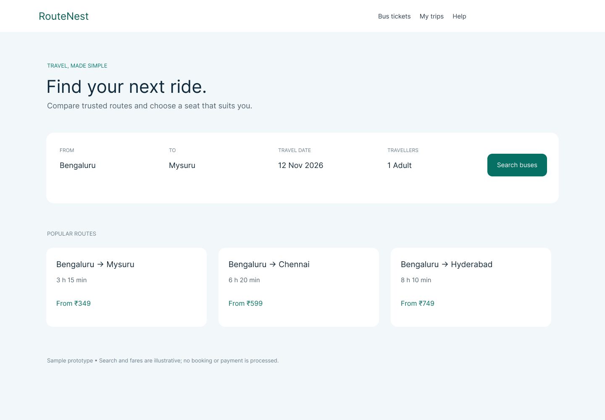

# Experiment 02 — RouteNest Bus Booking

## Aim
Design and document an original bus ticket booking experience for a Bengaluru–Mysuru journey.

## Tools Required
Figma, plus the local HTML/CSS/JavaScript prototype in website/.

## Algorithm
1. Identify the search, route comparison, seat choice, and booking-review steps.
2. Design the original RouteNest search screen in your Figma workspace.
3. Use the local prototype to explore route search, seat selection, and a sample booking review.
4. Check that fares and the demo-only status are clear.
5. Keep payment and live reservation processing out of the prototype.

## Figma File
[Open the RouteNest design in your account](https://www.figma.com/design/Y3tmdTkNGhnFigiG8TEixu)

## Output Screenshots

## Result
An original editable Figma search screen and local booking-flow prototype are available. The screen uses illustrative data; it does not reserve or charge for a ticket.
