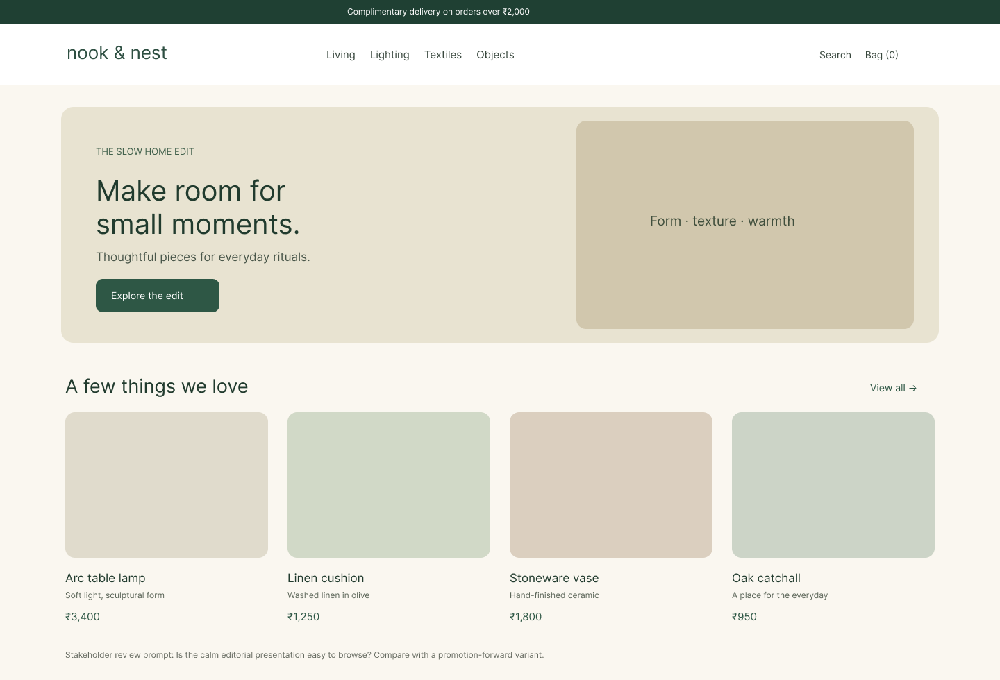

# Experiment 03 — Nook & Nest Stakeholder Prototype

## Aim
Create an original home-goods storefront concept and frame a stakeholder review around browsing hierarchy and product discovery.

## Tools Required
Figma, plus the local HTML/CSS/JavaScript prototype in app/.

## Algorithm
1. Define a calm editorial direction for the Nook & Nest brand.
2. Arrange navigation, a featured story, product cards, prices, and a review prompt.
3. Invite stakeholders to assess whether the hierarchy supports product discovery.
4. Use the local prototype’s view switch and feedback form to demonstrate comparison and capture sample feedback.
5. Treat entries as demonstration data until real stakeholders review the design.

## Figma File
[Open the Nook & Nest design in your account](https://www.figma.com/design/iGjfeEuj7Ytsn396i7QsdN)

## Output Screenshots

## Result
An original editable storefront screen and local stakeholder-review prototype are available. The screenshot is the calm editorial direction; the alternate hierarchy and feedback workflow are demonstrated in the local app.
