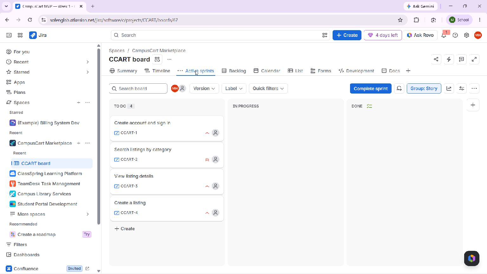
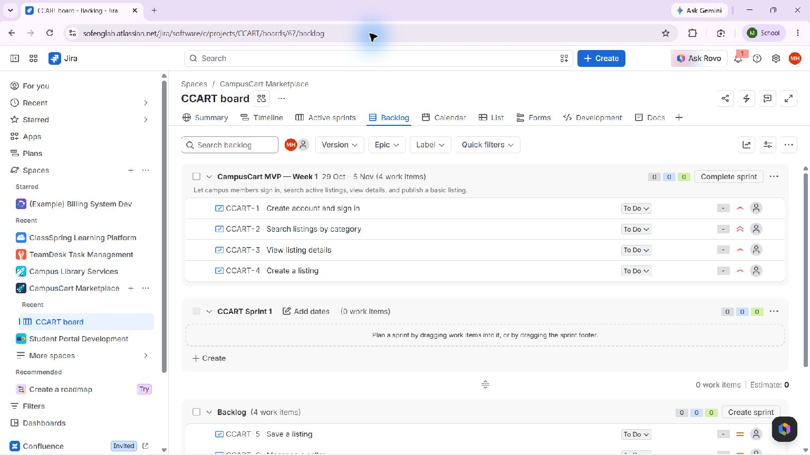
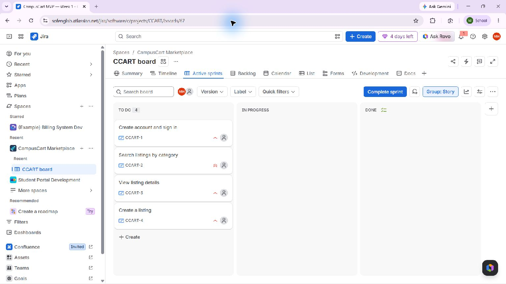

# Experiment 04 — CampusCart Jira Scrum Sprint

## Aim

Plan an original one-week Scrum sprint for CampusCart, a campus marketplace, using a live Jira Scrum backlog and an explicitly scoped MVP.

## Tools Required

- Jira Scrum project and board in the student's Atlassian account.
- Browser and the experiment's backlog/sprint planning records.
- Jira stories, estimates, dependency links, and sprint reporting.

## Quick access links

| What to open | Link |
| --- | --- |
| Live project and board | [CampusCart project](https://sofenglab.atlassian.net/browse/CCART) · [Sprint backlog](https://sofenglab.atlassian.net/jira/software/c/projects/CCART/boards/67/backlog) |
| Sprint plan and import data | [Sprint plan](sprint-plan.md) · [Backlog CSV](backlog.csv) · [Jira import CSV](jira-import.csv) |
| Screenshots | [Evidence folder](screenshots/) |

## Live Jira workspace

- **Project:** [CampusCart Marketplace (CCART)](https://sofenglab.atlassian.net/browse/CCART)
- **Live Scrum backlog and active sprint:** [CCART board 67](https://sofenglab.atlassian.net/jira/software/c/projects/CCART/boards/67/backlog)
- **Current sprint window:** 29 October–5 November 2026
- **Scope:** eight original stories total; all eight assigned to the active sprint.

## Algorithm and result

1. Define a marketplace goal: campus members can find active listings and sellers can publish a listing.
2. Create eight original story records covering account access, category search, listing detail, listing creation, saving, seller messaging, sold-state handling, and moderation reports.
3. Order Sprint 1 around the stated account/search/listing dependencies. Assign all eight original stories to the started one-week sprint so the complete prioritized backlog is visible in the live sprint view.
4. Start the active Jira sprint with the 29 October–5 November window. The linked Jira backlog is the source of truth for the current sprint and issue status.
5. Record estimates on the four selected stories (5, 5, 3, and 5 points; 18 total) and native prerequisite links: search blocks listing details, account access blocks listing creation, and listing detail/creation block later messaging and sold-state work.
6. Keep all items To Do until work and acceptance evidence exist. The screenshots document setup and backlog state; they do not claim that the marketplace has been implemented or the sprint completed.

The active sprint is underway. Jira still shows all four sprint stories To Do; the 18 points are an estimate, not completed effort. An end-of-sprint report is not available before 5 November 2026. Capture it after the sprint ends and update this report with actual outcomes; do not infer completion from the plan.

## Evidence

The screenshots below are captures of the connected CCART project in the authenticated Jira account. The backlog capture shows the eight-item active sprint. The start-board capture records the start configuration.

The current status screenshot is retained from sprint setup; the four live point values and dependencies were added afterward and can be verified in Jira. Jira’s sprint end and burndown outcome remain pending.

Local planning artifacts: [backlog.csv](backlog.csv), [Jira import data](jira-import.csv), and [one-week sprint plan](sprint-plan.md). These files preserve the original CampusCart requirements and acceptance criteria; Jira’s generated issue keys are CCART-1 through CCART-8.

## Result

The original CampusCart Scrum project is live in the user’s Atlassian account with all eight backlog stories assigned to the started, one-week sprint. Evidence includes the setup screenshots and the linked live board. Sprint delivery and end-of-sprint metrics remain pending the sprint end and actual work.
