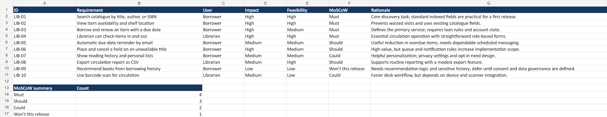

# Experiment 05 — Library requirements with MoSCoW

## Aim
Classify a library-system backlog using MoSCoW and justify decisions using user impact and delivery feasibility.

## Tools Required
Excel or compatible spreadsheet software.

## Algorithm
1. Define requirements from borrower, librarian, and administrator needs.
2. Score impact and feasibility as High, Medium, or Low.
3. Assign Must, Should, Could, or Won’t this release and record a concise rationale.
4. Review release scope and check the formula-based category totals.

## Output
[Download the original Library MoSCoW workbook](Library_MoSCoW.xlsx)

## Result
The workbook contains ten reasoned requirements and a calculated summary: four Must, three Should, two Could, and one deferred. These are planning judgments, not stakeholder survey findings.
