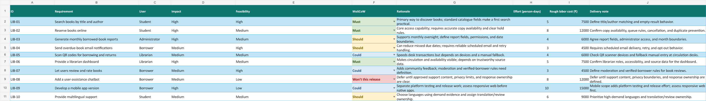
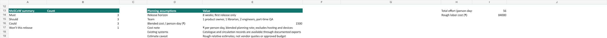

# Experiment 05 — Library requirements with MoSCoW

## Aim

Prioritize the ten library-system features listed in the lab PDF, with explicit impact, feasibility, rationale, effort, cost, and release assumptions.

## Prioritization result

| MoSCoW | Count | Release decision |
|---|---:|---|
| Must | 3 | Search books by title/author, reserve books online, and provide a librarian dashboard. |
| Should | 3 | Monthly admin reports, overdue email notifications, and multilingual support. |
| Could | 3 | QR-code borrowing/return, book reviews/ratings, and a mobile app. |
| Won’t this release | 1 | A chatbot is deferred until its support content, privacy boundaries, and answer quality can be validated. |

High-impact Must items enable discovery, access, and circulation oversight. Reporting and overdue email require reliable transaction history, scheduling, and delivery handling. QR and mobile depend on device/browser compatibility; reviews need moderation; multilingual support requires translated, reviewed interface text. Chatbot work is deferred until approved content and quality controls exist.

## Planning assumptions

The workbook assumes an eight-week first release, one product owner, one librarian, two engineers, part-time QA, existing catalogue/circulation exports, and ₹1,500 per person-day. The estimate is 56 person-days and ₹84,000 labor, excluding hosting, hardware, and translation services. It is a planning scenario, not an approved quote.

## Evidence

[Editable MoSCoW workbook](Library_MoSCoW.xlsx), with ten PDF-matched requirements, formulas, a summary, assumption block, filter, frozen headings, dropdown validation, and priority formatting.

The images are workbook previews; the workbook is the editable source.
