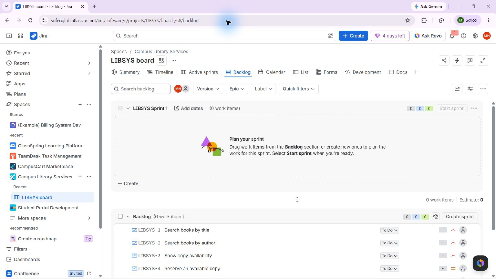
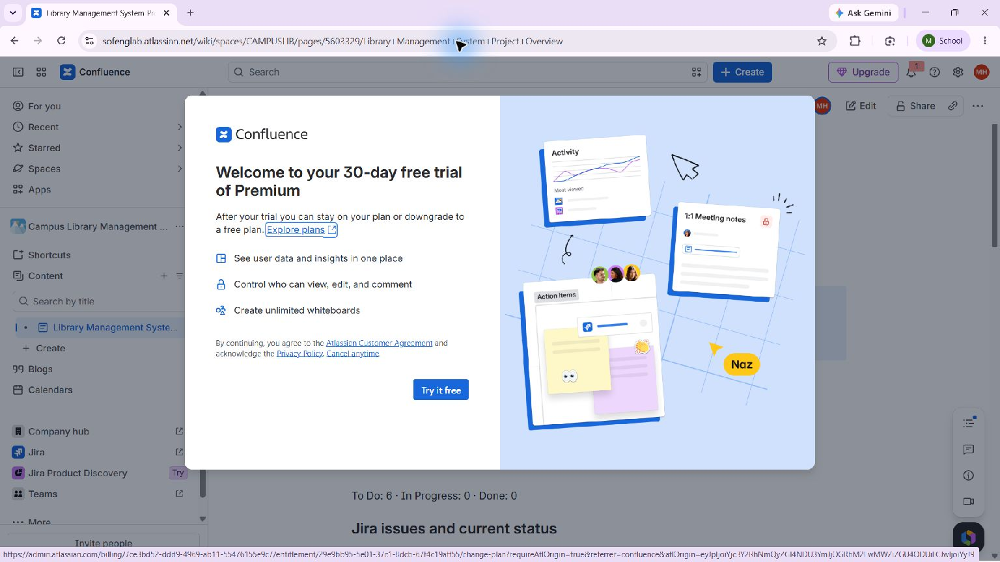

# Experiment 06 — Campus Library Jira and Confluence

## Aim

Connect an original library-service Jira backlog to a Confluence overview that reports the linked requirements and derives project progress from their real Jira statuses.

## Live workspace

- Jira project: [Campus Library Services (LIBSYS)](https://sofenglab.atlassian.net/browse/LIBSYS)
- Jira backlog: [LIBSYS board 68](https://sofenglab.atlassian.net/jira/software/c/projects/LIBSYS/boards/68/backlog)
- Confluence page: [Library Management System Project Overview](https://sofenglab.atlassian.net/wiki/spaces/CAMPUSLIB/pages/5603329/Library+Management+System+Project+Overview)
- Confluence space: Campus Library Management System (CAMPUSLIB)

## Work completed

1. Created six original library requirements as live Jira stories: title search, author search, copy availability, reservation, hold notification, and librarian circulation dashboard.
2. Published the Confluence overview page in the user’s account.
3. Added a project progress display and six individually linked issue rows with live statuses.
4. Added a Jira Issues macro filtered to `project = LIBSYS ORDER BY priority DESC`, displaying the live issue records and a direct board link.
5. Used the current status counts for the progress figure: 0 Done of 6 = 0%; To Do 6, In Progress 0, Done 0. No work is shown as complete before implementation evidence exists.

## Evidence

The live page is the primary evidence and can be opened using the link above. Its issue register identifies LIBSYS-1 through LIBSYS-6, and the Jira macro returns six live issues. [The live Jira backlog](https://sofenglab.atlassian.net/jira/software/c/projects/LIBSYS/boards/68/backlog) independently shows all six items in To Do.

**Screenshot note:** Atlassian displayed a Premium trial offer over the Confluence page during the capture. The offer is not accepted; the screenshot is retained transparently, and the readable, current page content can be verified directly at the live link. The live Jira backlog screenshot is unobstructed. No subscription or paid-plan change was made.

Local artifacts: [issue import CSV](jira-import.csv), [issue status snapshot](issues.csv), and [page structure draft](project-overview.md). The draft preserves the experiment’s structure; the published Confluence page is authoritative for live content and keys.

## Result

The Jira project and Confluence overview are published and linked in the user’s account. The current page presents six original tasks, live statuses, a status-derived 0% progress figure, and a Jira Issues macro. The report does not claim implementation, stakeholder approval, or task completion.
