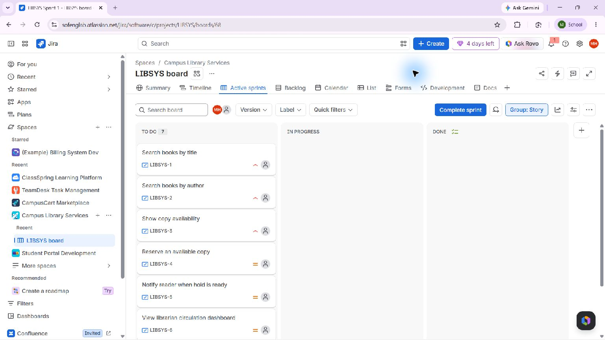

# Experiment 06 — Campus Library Jira and Confluence

## Aim

Connect an original library-service Jira backlog to a Confluence overview that reports the linked requirements and derives project progress from their real Jira statuses.

## Tools Required

- Jira project, backlog, sprint, stories, and issue links in the student's Atlassian account.
- Confluence space and page with a Jira Issues macro.
- Browser and local CSV/page-outline records for review.

## Quick access links

| What to open | Link |
| --- | --- |
| Live workspace | [LIBSYS board](https://sofenglab.atlassian.net/jira/software/c/projects/LIBSYS/boards/68/backlog) · [Confluence overview](https://sofenglab.atlassian.net/wiki/spaces/CAMPUSLIB/pages/5603329/Library+Management+System+Project+Overview) |
| Source planning records | [Issues CSV](issues.csv) · [Jira import CSV](jira-import.csv) · [Confluence page draft](project-overview.md) |
| Screenshots | [Evidence folder](screenshots/) |

## Live workspace

- Jira project: [Campus Library Services (LIBSYS)](https://sofenglab.atlassian.net/browse/LIBSYS)
- Jira backlog: [LIBSYS board 68](https://sofenglab.atlassian.net/jira/software/c/projects/LIBSYS/boards/68/backlog)
- Confluence page: [Library Management System Project Overview](https://sofenglab.atlassian.net/wiki/spaces/CAMPUSLIB/pages/5603329/Library+Management+System+Project+Overview)
- Confluence space: Campus Library Management System (CAMPUSLIB)

## Algorithm

1. Created seven original library requirements as live Jira stories: title and author search, copy availability, reservation, hold notification, circulation dashboard, and monthly circulation report.
2. Published and expanded the Confluence overview page in the user’s account with a linked issue register, seven-story progress summary, sprint schedule, estimate and responsibility plan, risks, and Definition of Done.
3. Added a Jira Issues macro filtered to `project = LIBSYS ORDER BY priority DESC`, displaying the live issue records and a direct board link.
4. Created native prerequisite links for search/availability to reservation, reservation to hold notice, and the dashboard to monthly reporting.
5. Started `LIBSYS Sprint 1` for 29 October–5 November 2026 with all seven stories and 21 estimated points. Current status counts: 0 Done of 7 = 0%; To Do 7, In Progress 0, Done 0. No work is shown as complete before implementation evidence exists.

## Evidence

The live page is the primary evidence and can be opened using the link above. Its issue register and Jira macro cover LIBSYS-1 through LIBSYS-7. [The live Jira sprint board](https://sofenglab.atlassian.net/jira/software/c/projects/LIBSYS/boards/68) independently shows seven active sprint issues in To Do.

**Screenshot note:** Atlassian displayed a Premium trial offer over the Confluence page during the capture. The offer is not accepted; the screenshot is retained transparently, and the readable, current page content can be verified directly at the live link. The live Jira backlog screenshot is unobstructed. No subscription or paid-plan change was made.

Local artifacts: [issue import CSV](jira-import.csv), [current issue/sprint snapshot](issues.csv), and [page structure draft](project-overview.md). The draft and live page use the same original library requirements and current seven-story scope.

## Result

The Jira project and Confluence overview are published and linked in the user’s account. The project has seven original requirements, an active 21-point sprint, explicit prerequisites, schedule and risk guidance, live issue statuses, a status-derived 0% progress figure, and a Jira Issues macro. The report does not claim implementation, stakeholder approval, or task completion.
