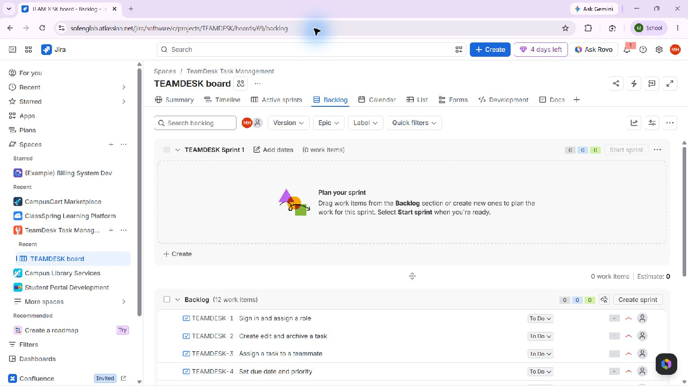
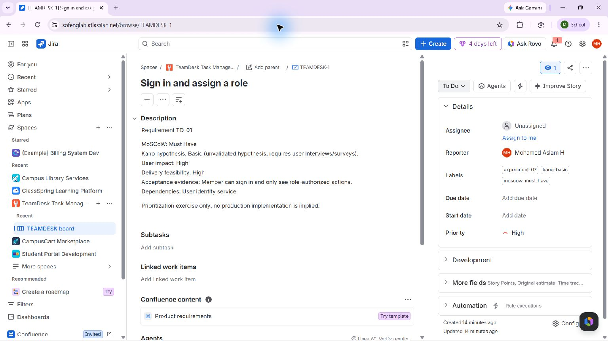
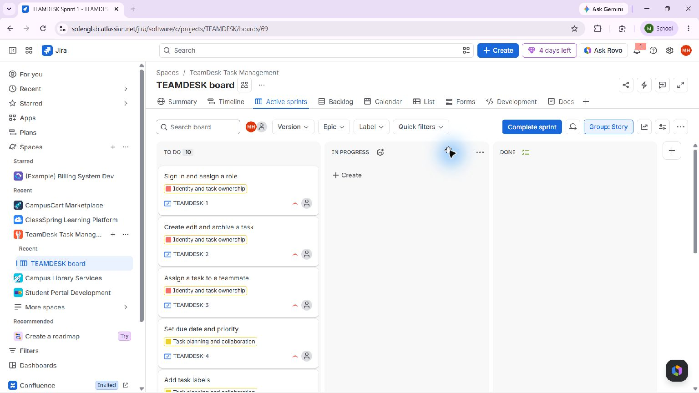

# Experiment 07 — TeamDesk Task Management Prioritization

## Aim

Prioritize original team task-management requirements using MoSCoW for release scope and Kano for expected satisfaction. Kano values remain hypotheses until user research validates them.

## Live Jira workspace

- Project: [TeamDesk Task Management](https://sofenglab.atlassian.net/browse/TEAMDESK)
- Live backlog: [TEAMDESK board 69](https://sofenglab.atlassian.net/jira/software/c/projects/TEAMDESK/boards/69/backlog)
- Requirement detail example: [TEAMDESK-1](https://sofenglab.atlassian.net/browse/TEAMDESK-1)

## Method and result

1. Break the original task-management scope into 12 testable requirements covering access, task lifecycle, assignment, planning, collaboration, reminders, export, and automation. Organize them under four original feature epics in Jira.
2. Assign MoSCoW scope independently from Jira Priority. The release proposal is 4 Must, 4 Should, 3 Could, and 1 Won’t this release.
3. Assign an independent provisional Kano expectation: 3 Basic, 5 Performance, 3 Attractive, and 1 Indifferent. These are explicitly unvalidated hypotheses, not survey results.
4. Record impact, feasibility, acceptance evidence, dependencies, and paired future Kano questions in each Jira description. Add category labels (`moscow-*`, `kano-*`) for searchable classifications.
5. Start a sample one-week sprint with the 10 Must/Should and two selected Could stories: 4 Must, 4 Should, 2 Could, 24 points. TD-11 and TD-12 remain in backlog. All 10 sprint stories are currently To Do (0% complete); statuses do not claim implementation.
6. Add 12 native prerequisite links and assign all 12 stories to the feature epics.

See the complete original [requirements matrix](requirements.csv) and [decision record](decision-record.md). The issue keys are TEAMDESK-1 through TEAMDESK-12 in requirement-ID order.

## Evidence

The detail screenshot and live issue show how the two models are recorded on the account side. Jira uses issue descriptions plus searchable labels in this project; separate native MoSCoW/Kano dropdown columns and saved filters could not be configured through the available account operations. [Ready-to-run JQL views](filter-queries.md) provide the same classification slices without claiming they are saved Jira filters. Kano research has not been conducted.

See the [active sprint plan](sprint-plan.md), [12-story requirement matrix](requirements.csv), and [release decision record](decision-record.md). The epic hierarchy and sprint are live in Jira; estimates and the 12 dependencies are native Jira data.

## Result

The 12 original requirements are in the user’s live Jira account with four epics, separate MoSCoW and provisional Kano classifications, explicit rationale, acceptance evidence, paired validation questions, dependencies, estimates, and an active 24-point sprint. All sprint items remain To Do. No customer validation or implementation is claimed.
