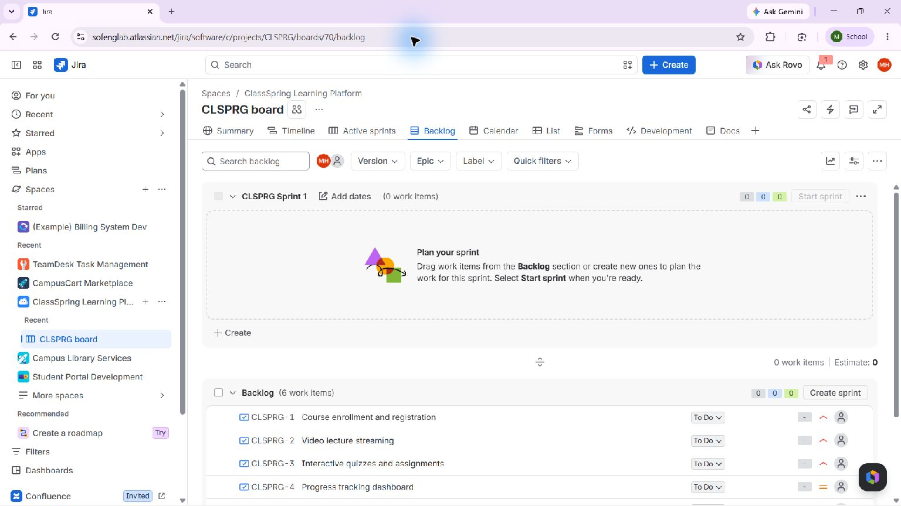
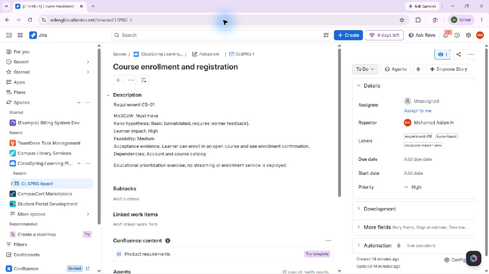
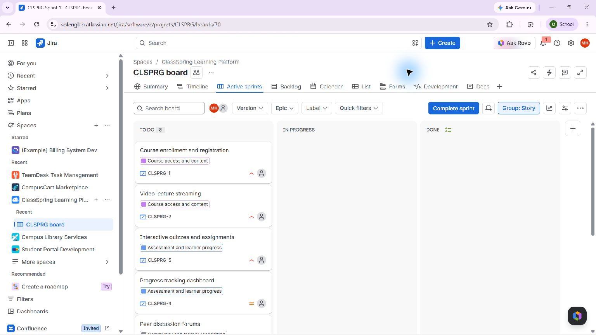

# Experiment 08 — ClassSpring Online Learning Prioritization

## Aim

Prioritize nine original online-learning capabilities using MoSCoW release scope and Kano satisfaction hypotheses, with acceptance evidence, paired research questions, prerequisites, and an active sample sprint.

## Live Jira workspace

- Project: [ClassSpring Learning Platform](https://sofenglab.atlassian.net/browse/CLSPRG)
- Live board: [CLSPRG board 70](https://sofenglab.atlassian.net/jira/software/c/projects/CLSPRG/boards/70)
- Requirement example: [CLSPRG-1](https://sofenglab.atlassian.net/browse/CLSPRG-1)
- Sprint: CLSPRG Sprint 1 · 29 October–5 November 2026

## Method and result

1. Define the six original capabilities—enrollment, lecture streaming, assessments, progress tracking, discussion, and certificates—plus bookmarks/notes, milestone acknowledgements, and a study assistant deferred from the first release.
2. Set MoSCoW scope independently from urgency: 2 Must, 2 Should, 4 Could, and 1 Won’t this release.
3. Record 2 Basic, 3 Performance, and 4 Attractive Kano hypotheses. Each story includes a paired functional/dysfunctional question for future learner research; no survey has been run.
4. Organize the nine stories under three feature epics, record impact, feasibility, acceptance evidence and prerequisites, and add 14 native dependency links.
5. Start an eight-story, 22-point sprint. The AI assistant stays outside it. Current status: 8 To Do, 0% complete; this is a planning baseline and not implementation evidence.
6. Use searchable model labels and [live JQL view links](filter-queries.md). Separate native MoSCoW/Kano dropdown fields and saved filters were not available through the connected Jira operations.

The [nine-story requirement register](requirements.csv), [decision record](decision-record.md), and [active sprint plan](sprint-plan.md) preserve the original ClassSpring scenario. The JIRA hierarchy and sprint are linked above.

## Evidence

The detail view shows saved classifications, acceptance details, and labels. The live project does not have separate native MoSCoW/Kano dropdown columns. The new board screenshot documents the active sprint and epic hierarchy. All Kano classifications remain hypotheses, not validated learner findings.

## Result

The nine original learning-platform capabilities are prioritized in the user’s Jira project with three feature epics, MoSCoW, provisional Kano, learner impact, feasibility, paired validation questions, acceptance evidence, estimates, and dependencies. The active 22-point sprint remains To Do. No implementation or learner validation is claimed.
