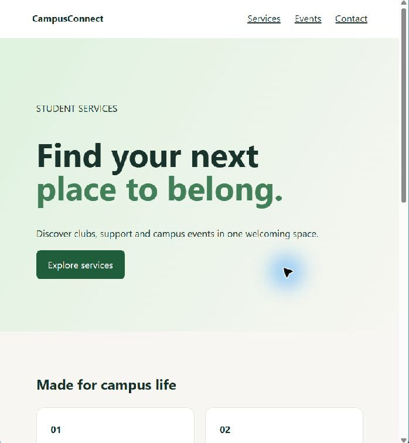

# Experiment 11 — Static website in Docker with Nginx

## Aim

Create an original campus-support landing page, package it as a static Nginx image, run it as a container, and inspect it in a browser.

## Tools Required

- Git and a code editor.
- Docker Desktop with Linux containers for the container exercise.
- Nginx (provided by the Docker base image) and a web browser.
- PowerShell or another terminal.

## Quick access links

| What to open | Link |
| --- | --- |
| CampusConnect source page | [website/index.html](website/index.html) |
| Local browser preview capture | [Screenshot](screenshots/campusconnect-browser-preview.png) |
| Container build | [Dockerfile](Dockerfile) |
| Nginx site and health endpoint | [nginx.conf](nginx.conf) |
| Portfolio report and all experiments | [Experiment 11 report](README.md) · [Portfolio index](../../README.md) |

## Files

- `website/index.html` and `website/styles.css`: responsive CampusConnect page.
- `nginx.conf`: serves the static site, provides `/healthz`, and returns 404 for missing paths.
- `Dockerfile` and `.dockerignore`: package only the site and Nginx configuration, expose port 80, and define a container health check.

## Procedure

From this directory run:

```powershell
docker build -t campusconnect-static:1.0 .
docker run --rm -d --name campusconnect -p 8080:80 campusconnect-static:1.0
```

Open [http://localhost:8080](http://localhost:8080), inspect the responsive layout, then stop it with `docker stop campusconnect`.

## Algorithm

1. Build a semantic, responsive campus-support page with services, events and contact sections.
2. Configure Nginx to serve the static files and provide `/healthz`.
3. Build an image that contains the site and server configuration, then run it with the host port mapped to container port 80.
4. Inspect the page and health endpoint, then stop and remove the container.

## Evidence and result

The source page and a real local-browser preview are included below. The hosted [Experiment 14 Actions run #3](https://github.com/Md-Aslam-31/CSA1020_SOFTWARE_ENGINEERING/actions/runs/40846745087) built the image, ran it, and checked `/` and `/healthz`. The live Pages preview is a separate static source preview, not the container instance.


