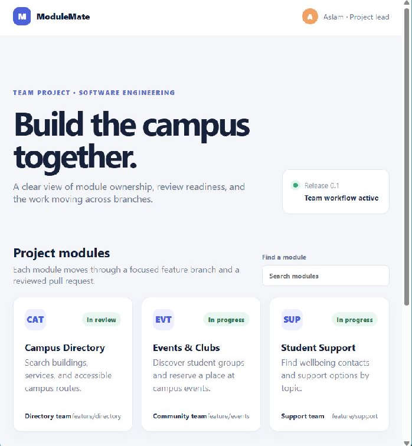

# Experiment 15 — ModuleMate team project and version-control workflow

## Aim

Create an original small-team project workspace and define an auditable GitHub workflow for module ownership, feature branches, pull-request review, and conflict resolution.

## Tools Required

Git and GitHub.

## Project

[Open the ModuleMate prototype](app/index.html). It presents three independently owned modules (Campus Directory, Events & Clubs, Student Support), their sample branch names and review states, and supports a live module search. The page is a local static prototype; displayed owners/statuses illustrate a workflow and do not claim that separate people or GitHub PRs exist.

## Team workflow

1. Protect `main` and require a successful check before merge.
2. Create a focused branch from the latest main: `feature/directory`, `feature/events`, or `feature/support`.
3. Keep a module change small and update the README when setup or behavior changes.
4. Open a pull request with the issue, summary, acceptance checklist, and test output.
5. Review the diff, request focused changes, and rerun checks after follow-up commits.
6. Fetch and merge current `main` into a feature branch before integration. Resolve conflicts by preserving both module requirements, remove markers, run checks, then push the resolution.
7. Merge through the PR after review and checks pass; delete the remote branch only after integration.

## Evidence and result

The original UI source and branch/review procedure are included. The PR and conflict steps are reproducible instructions, but this run did not create separate collaborator accounts, GitHub branches, reviews, or PRs, so no independent-review or merge evidence is claimed. GitHub CLI and authenticated GitHub PR creation are unavailable in this authoring environment.

This is a real browser capture of the local prototype; it documents the UI only, not remote GitHub workflow activity.

