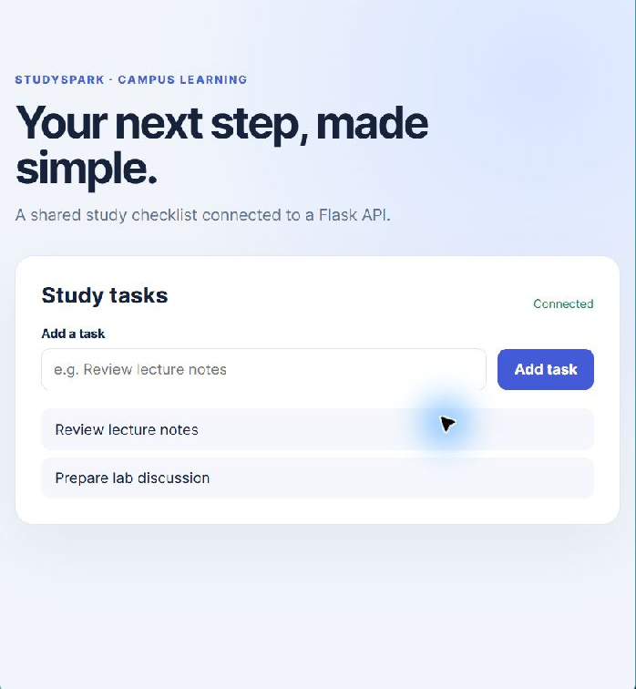

# Experiment 18 — Multi-container StudySpark on Kubernetes

## Aim

Deploy a small learning task app with a browser frontend, Flask API, and PostgreSQL database. Provide service discovery, persistent database storage, health checks, and scalable web/API deployments.

## Architecture and artifacts

- `frontend/`: responsive StudySpark page served by Nginx; Nginx proxies `/api` to the API Service.
- `backend/`: Flask API stores and lists tasks through SQLAlchemy and PostgreSQL; SQLite is used for isolated unit tests.
- `compose.yaml`: local three-service development stack with a named PostgreSQL volume and health checks.
- `k8s/studyspark.yaml`: PostgreSQL Stateful backing resources (Deployment/PVC/Service), API and frontend Deployments, and Services including NodePort 30080.

## Quick access links

| What to open | Link |
| --- | --- |
| Browser frontend and local preview capture | [StudySpark page](frontend/index.html) · [Local screenshot](screenshots/studyspark-local-browser.png) |
| Flask API and passing test output | [API source](backend/app.py) · [3 passing tests](evidence/api-tests.txt) |
| Multi-service container stack | [Compose file](compose.yaml) |
| Cluster resources | [Kubernetes manifest](k8s/studyspark.yaml) |
| Portfolio index | [All experiments](../../README.md) |

## Run locally with Compose

From this directory:

```powershell
docker compose up --build -d
docker compose ps
Invoke-RestMethod http://localhost:8080/health
Invoke-RestMethod http://localhost:8080/api/tasks
```

Open [http://localhost:8080](http://localhost:8080), add a task, and confirm it remains after refreshing. Stop with `docker compose down`; keep the named volume to retain the data. Use `docker compose down -v` only when intentionally deleting the lab database.

## Deploy to Kubernetes

Build and push the API and frontend images, then replace `YOUR_REGISTRY` in the manifest. Replace the demo database password before applying; for a real cluster, create the `studyspark-db` Secret through the cluster secret manager and omit the sample Secret document. Apply in a lab namespace, verify pods/PVC/services, and scale the frontend with `kubectl scale deployment/studyspark-frontend --replicas=4`. Use `kubectl port-forward service/studyspark-frontend 8080:80` to access it; NodePort 30080 is cluster-network dependent.

```powershell
docker build -t YOUR_REGISTRY/studyspark-api:1.0 backend
docker build -t YOUR_REGISTRY/studyspark-frontend:1.0 frontend
docker push YOUR_REGISTRY/studyspark-api:1.0
docker push YOUR_REGISTRY/studyspark-frontend:1.0
kubectl apply -f k8s/studyspark.yaml
kubectl get pods,services,pvc
```

## Local preview without Docker

For a browser/API preview while Docker is unavailable, open two terminals. In the first, install `backend/requirements.txt` and run `py app.py` from `backend/`. In the second, run `py preview_server.py` from `frontend/`. Open [http://127.0.0.1:8080](http://127.0.0.1:8080); the Python preview server serves the page and proxies API requests to Flask on port 5000. With no `DATABASE_URL`, this fallback uses a temporary local SQLite database, not PostgreSQL or Kubernetes.



This screenshot documents the local frontend/API preview only. It is not Docker Compose or Kubernetes dashboard evidence.

## Verification and result

The API tests exercise database health, create/list persistence, and title validation; run them with `python -m pip install -r backend/requirements.txt` then `python -m unittest discover -s backend -v`. The captured output is in [evidence/api-tests.txt](evidence/api-tests.txt). Docker and kubectl are not installed in the authoring environment, so container and cluster results are not represented as completed. The manifests and reproducible steps are included; no screenshot of a live deployment is claimed.
